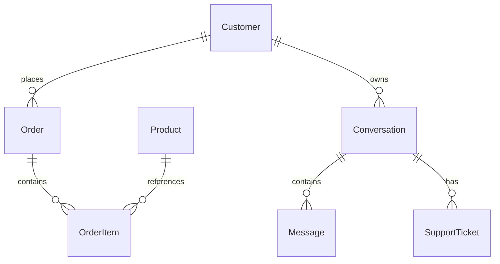

# Architecture

CustomerOps AI is a modular monolith. Implemented: application composition, settings,
health/readiness, async PostgreSQL, seven relational models, Alembic, fictional seeds,
Docker infrastructure, authenticated business services/repositories, a bounded OpenAI Responses
agent, persistent ChromaDB RAG, and PostgreSQL/agent/RAG tests. WhatsApp and UI remain reserved. Redis exists only
as a local container. See [agent architecture and setup](agent.md) for the chat path.

## Boundaries

| Package | Responsibility |
| --- | --- |
| `main.py` | Compose settings, routers, and lifespan-owned resources |
| `api/` | HTTP contracts, dependencies, error mapping; no business SQL |
| `schemas/` | Pydantic transport contracts, independent of ORM serialization |
| `core/` | Environment-based validated configuration |
| `models/` | SQLAlchemy entities, relationships, enums, constraints |
| `infrastructure/` | Engine, session factory, request dependency, shutdown |
| `services/` | Customer operations, ownership, ticket limits, chat and knowledge ingestion/search |
| `repositories/` | Bounded persistence queries using injected sessions |
| `agents/` | Provider boundary, orchestration, strict registry, execution |
| `integrations/` | Official async OpenAI Responses SDK adapter |
| `rag/` | Text extraction/chunking, OpenAI embeddings, Chroma persistence, evaluation |

Current chat flow: authenticated route -> chat service -> orchestrator -> validated tools ->
business services -> repositories. The provider sees only scoped text and tool results.
Do not add generic repositories,
service containers, microservices, or implicit integration behavior in advance.

## Relational model

- Every table has a UUID primary key, timezone-aware creation/update timestamps, server
  defaults, and an update trigger. ORM IDs default to UUIDv4; fictional fixture IDs use UUIDv5.
  Triggers cover raw SQL updates and use `clock_timestamp()`.
- Customers have unique lowercase emails. Products have unique SKUs, category/name indexes,
  nonnegative stock and decimal `Numeric(12,2)` prices. Currency is three uppercase letters;
  validating recognized ISO currencies is a future service policy.
- Orders have unique numbers, customer/time and status indexes, shipping address, optional
  tracking reference, and status. Items snapshot product name and unit price; quantity must
  be positive and each product appears once per order. Prices use `Decimal`, never floats.
  Order totals are not redundantly stored.
- Conversations reference customers and have channel/status. Messages have role/nonempty
  content and a conversation/time/UUID index. Tickets derive customer ownership through the
  conversation and have status, priority, and optional human assignee.
- Non-native SQLAlchemy enums store public string values with named CHECK constraints.
  Adding enum values requires a migration, not just a Python change.
- Customer deletion is restricted while orders/conversations exist; product deletion is
  restricted while items reference it. Deleting an order cascades to items. Deleting an
  unticketed conversation cascades to messages; tickets restrict conversation deletion.
- Relationships use `lazy="raise"` to prevent implicit blocking I/O. Use explicit eager
  loading/queries. FK lookup indexes include composite indexes led by their FK column.

Order/conversation ownership and limited ticket opening are implemented through services.
Stock/payment transitions, cross-row currency validation, nonempty-order policies, full ticket
lifecycle APIs and comprehensive anonymization remain future work; conversation retention is implemented. Ticket opening sets a waiting
state that stops automated turns; no live human connection or notification is implemented.

## Engine and transactions

`Database` owns a SQLAlchemy async engine using `asyncpg`, bounded pooling, pre-ping,
timeouts, and hidden SQL parameters. FastAPI lifespan creates the pool and disposes it on
shutdown. Startup does not connect, migrate, or seed. Without a database password, database
access is disabled and liveness still works.

`get_session` yields a request-scoped `AsyncSession`; `DatabaseSession` is its annotated
FastAPI alias. Sessions disable expiration after commit and automatic flush. Business services
explicitly flush/commit, or use `async with session.begin()`. ChatService commits whole turns
atomically and serializes them with a bounded NOWAIT customer row lock. Session close rolls back
uncommitted work, including exceptional exits. Never share a session between concurrent tasks.

## Migrations and health

Alembic owns schema changes. Settings builds escaped URL components; `env.py` uses an async
connection plus `run_sync`. Offline SQL generation and injected connections are supported.
Revisions contain explicit frozen DDL and never import mutable application model definitions.
Constraint naming conventions keep autogeneration predictable. Maintain trigger DDL explicitly:
Alembic autogeneration does not inspect trigger bodies or all CHECK expressions.

`/api/v1/health` reports HTTP process liveness. `/api/v1/ready` requires connectivity and
revision `0002_memory`. Additions to migration history must update the readiness expectation
and tests. This is not a full integrity audit or Redis check. Failures return sanitized 503s.

## Infrastructure and secrets

Compose starts PostgreSQL/Redis with health checks, completes one-shot migrations, then starts
a non-root backend. Failed migrations block startup. Only the backend is published by default,
on loopback. Named volumes persist development data. PostgreSQL 18 mounts its versioned data
under `/var/lib/postgresql`.

Database passwords come from environment variables. `.env` and `.local` are excluded from Git
and build contexts. URL component construction supports reserved password characters. The
separate test PostgreSQL profile uses temporary storage and a loopback-only port. Redis has
no app client or cache semantics yet; its unexposed local development container has no password.
Production TLS, least-privilege role provisioning, backups, and digest pinning remain future work.

## Fixtures and verification

Seeding uses stable fixture IDs/times, reserved domains, insert-only conflicts, one transaction,
and an advisory lock. It does not reset changed rows or pretend external integrations work.
Explicit CLI confirmation is required and production settings are rejected.

Tests require a separate `_test` database, rejecting the development database name. Each test
creates a UUID-named schema, sets the search path, applies real Alembic migrations, and drops
only that schema. NullPool and function-scoped loops avoid cross-loop asyncpg reuse. Tests do
not use `metadata.create_all` or SQLite. Required CI runs cannot skip missing database setup.

Python dependency versions are constrained in `requirements.lock`. Container patch tags are
pinned but remain mutable upstream; image digest and build-tool locking are not claimed.
See [verification](verification.md) for actual local evidence and environmental limitations.

## Agent and planned integrations

The agent uses an async OpenAI Responses adapter, bounded turn/tool budgets, and six validated
allowlisted tools. Server-managed bearer authentication supplies identity, and services enforce
order/conversation ownership. Strict schemas are validated independently by the executor.
See [agent.md](agent.md) for failure semantics, context bounds, logging, and live verification.
RAG ingests administrator-approved PDF/Markdown/text documents into persistent ChromaDB.
A local SQLite manifest atomically selects immutable document index generations and retains
raw bytes for re-indexing. This manifest is infrastructure metadata, not a replacement for
PostgreSQL business repositories. Extraction/Chroma/filesystem operations run off the event loop;
embeddings use the asynchronous OpenAI SDK. Search merges per-document cosine results with
metadata filters and a configurable cutoff. See [RAG design and limitations](rag.md).
Retrieved text remains untrusted; only allowlisted business tools may mutate customer data.
PostgreSQL owns durable conversation/escalation state. Redis is reserved for a justified cache
or coordination use case. External channel delivery remains unimplemented.

Primary references: [SQLAlchemy async sessions](https://docs.sqlalchemy.org/en/20/orm/extensions/asyncio.html),
[Alembic async cookbook](https://alembic.sqlalchemy.org/en/latest/cookbook.html#using-asyncio-with-alembic),
[Compose startup dependencies](https://docs.docker.com/compose/how-tos/startup-order/), and
[OpenAI SDK](https://developers.openai.com/api/reference/python) for the provider boundary.

## Persistent conversation memory

`services/memory.py` builds customer-scoped bounded context through `repositories/memory.py`.
PostgreSQL messages have an identity sequence and JSONB audit metadata. Conversations retain
bounded, extractive customer excerpts with a covered-through sequence and explicit last activity.
The summary never becomes a privileged model instruction. Conversation APIs use owned queries
and retention visibility without requiring the LLM provider. The operator-run retention service
uses the existing customer locks to coordinate physical cleanup with chat. See [memory.md](memory.md)
for exact policies, data minimization, transaction rollback and concurrency tradeoffs.
